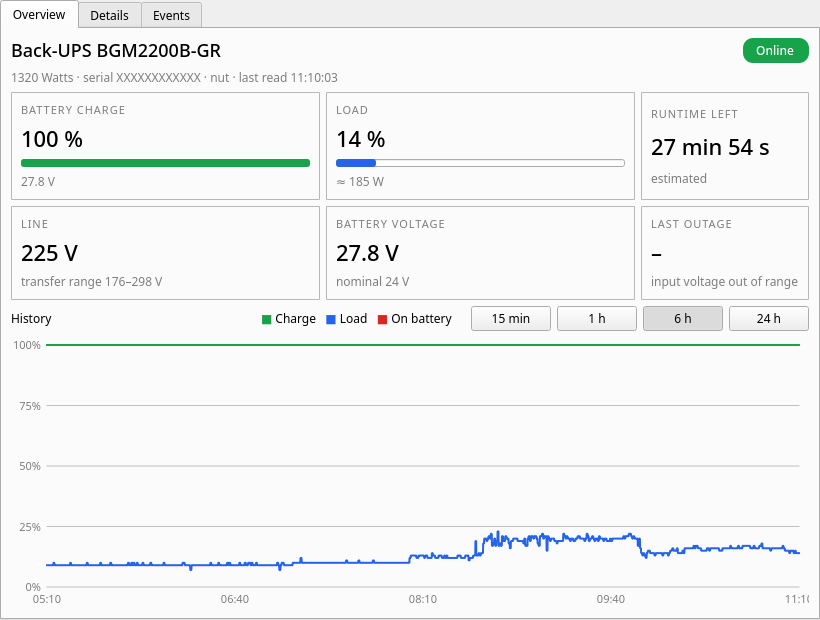

# UPS Tray

A small system tray monitor for UPS devices on Linux. Works with [NUT](https://networkupstools.org/) (`upsc`) or apcupsd (`apcaccess`).



- Tray icon shows battery level and status (green: online, red: on battery, gray: no connection)
- Notifications for power failure, power restored, low battery and lost connection
- Window with live values, 24 h history chart, all UPS variables and the event log
- English and Turkish UI (follows system language, override with `UPS_TRAY_LANG=en|tr`)

## Install

Requires Python 3 and PyQt6 (`pacman -S python-pyqt6` / `apt install python3-pyqt6`).

```sh
git clone https://github.com/Denkiyaa/ups-tray.git
cd ups-tray
./install.sh              # or ./install.sh --autostart
```

Then launch **UPS Tray** from the app menu. Uninstall with `./install.sh --uninstall`.

If both are installed, NUT is preferred. Use `--ups name@host` to pick a specific NUT UPS.

## NUT setup

Some newer APC models (e.g. Back-UPS BGM/BX series) are reported as *on battery* by apcupsd even when on mains. NUT's `usbhid-ups` driver handles them correctly. For a single USB UPS:

```sh
sudo pacman -S nut          # or: sudo apt install nut
sudo bash setup_nut.sh      # configures NUT standalone, disables apcupsd
```

## License

MIT
